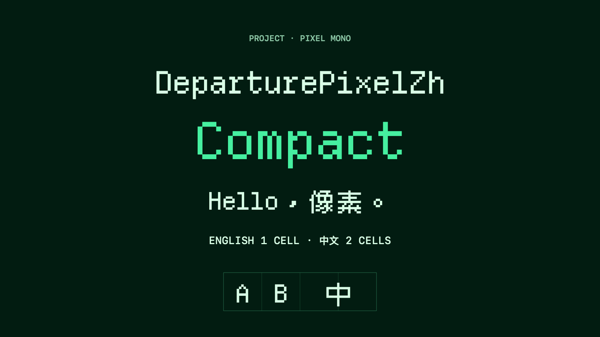

# DeparturePixelZh

[English](README.md) · [简体中文](README.zh-Hans.md) · [日本語](README.ja.md) · [한국어](README.ko.md) · [Español](README.es.md)

## Resumen

Letras inglesas y caracteres chinos de estilo píxel en una sola fuente monoespaciada. Los caracteres latinos ocupan una celda; los caracteres chinos de ancho completo, dos. Incluye iconos para desarrolladores. Los emoji en color usan la fuente del sistema.

[TTF para escritorio](https://github.com/codingEzio/DeparturePixelZh-OSS/releases/download/v0.1.1/DeparturePixelZh-0.1.1-desktop.zip) · [WOFF2 para la web](https://github.com/codingEzio/DeparturePixelZh-OSS/releases/download/v0.1.1/DeparturePixelZh-0.1.1-web.zip) · [Todas las versiones](https://github.com/codingEzio/DeparturePixelZh-OSS/releases)

Ambos paquetes incluyen Standard y Compact, sumas de comprobación, registros de origen y avisos de licencia. Los registros originales sobre los derechos de algunos iconos difieren; consulta [NOTICE.md](NOTICE.md) para conocer las condiciones de componentes y marcas.



Combina [Departure Mono](https://github.com/rektdeckard/departure-mono), [Cubic 11](https://github.com/ACh-K/Cubic-11) y Nerd Fonts Symbols Mono.

## Elegir una fuente

| Familia | Nombre PostScript | Espaciado |
| --- | --- | --- |
| DeparturePixelZh | `DeparturePixelZh-Regular` | Estándar |
| DeparturePixelZh Compact | `DeparturePixelZhCompact-Regular` | Un 7,14% más estrecho |

Ambas son fuentes Regular, sin cursiva y con la misma altura de línea. Compact ya adapta las formas y el espaciado; no hace falta cambiar el espaciado en la aplicación.

## Uso

Instala el TTF en el escritorio y usa WOFF2 en la web. Los paquetes incluyen las fuentes, sumas de comprobación, registros de origen y avisos de licencia. Conserva `OFL.txt`, `NOTICE.md` y `Licenses/` al redistribuir las fuentes o incluirlas en una aplicación.

Consulta la [guía de instalación y uso web](INSTALL.md). Los archivos de lanzamiento usan `Licenses/`; el repositorio de código usa `licenses/`.

Las aplicaciones de Apple que registren una fuente incluida deben usar su nombre PostScript exacto. En la web, carga el WOFF2 sin una fuente `local()` y conserva una alternativa del sistema.

## Reconstruir

Instala [uv](https://docs.astral.sh/uv/), clona el [Builder](https://github.com/codingEzio/DeparturePixelZhBuilder-OSS) y cambia a la revisión exacta de [builder-version](builder-version). Ejecuta el comando siguiente desde este directorio de fuentes, sustituye `/path/to/builder-review-git` por la ruta elegida y mantén limpio el árbol de trabajo.

```sh
git clone https://github.com/codingEzio/DeparturePixelZhBuilder-OSS.git "/path/to/builder-review-git"
git -C "/path/to/builder-review-git" checkout --detach "$(cat builder-version)"
```

```sh
uv run --frozen --project "/path/to/builder-review-git" departurepixelzh-builder build --recipe "/path/to/font-source/recipe.json" --output "/path/to/font-build"
uv run --frozen --project "/path/to/builder-review-git" departurepixelzh-builder check --recipe "/path/to/font-source/recipe.json" --output "/path/to/font-build" --release
```

En macOS, ejecuta `swift scripts/check_native.swift "/path/to/font-build"` desde un checkout de fuentes para comprobar las fuentes con el sistema nativo. La ruta explícita de desarrollo con instantáneas se explica a continuación.

En un checkout de fuentes, [recipe.json](recipe.json) fija las URL de origen y los valores SHA-256. El constructor descarga los archivos desde esas URL o reutiliza copias en caché, y los valida con los valores fijados. Nunca lee fuentes instaladas en macOS como entrada de compilación. El [consumer-fixture/](consumer-fixture/) del checkout muestra cómo copiar fuentes verificadas, avisos y registros de origen a un proyecto que las use; no se incluye en los ZIP de fuentes tipográficas.

### Git del constructor fijado y exportaciones solo de código

Para `build` de publicación sin `--development`, `check --release` y `package` se necesita el checkout Git limpio de la revisión exacta del Builder y una procedencia de compilación coincidente. El renderizado nativo y la instalación requieren comprobaciones separadas.

```sh
uv run --frozen --project "/path/to/builder-source" departurepixelzh-builder build --recipe "/path/to/font-source/recipe.json" --output "/path/to/font-build" --development
uv run --frozen --project "/path/to/builder-source" departurepixelzh-builder check --recipe "/path/to/font-source/recipe.json" --output "/path/to/font-build"
```

## Cobertura y límites

Departure Mono tiene prioridad cuando las fuentes comparten un carácter. Cubic 11 completa la cobertura china y Nerd Fonts Symbols Mono aporta los iconos de uso privado. Los archivos de cobertura generados indican el origen de cada punto de código incluido.

Solo se ofrecen estilos Regular sin cursiva. Los caracteres no incluidos y los emoji en color necesitan fuentes alternativas. El aspecto depende del tamaño, la escala de pantalla y la aplicación. El proyecto no afirma haber verificado la representación en todas las plataformas.

## Opcional: comparar las fuentes originales

En macOS con Homebrew, puedes instalar las fuentes originales para comparar su aspecto. No es un requisito de compilación ni hace falta para instalar o usar DeparturePixelZh.

```sh
brew install --cask font-departure-mono font-cubic-11
```

## Licencia

Las fuentes usan la [SIL Open Font License 1.1](OFL.txt). Consulta [NOTICE.md](NOTICE.md) y las licencias de los componentes para conocer la atribución, los cambios, los nombres reservados y las condiciones. El checkout de fuentes usa [licenses/](https://github.com/codingEzio/DeparturePixelZh-OSS/tree/main/licenses); los ZIP de fuentes tipográficas usan `Licenses/`. DeparturePixelZh es un nombre derivado independiente; no implica el respaldo de los autores originales ni de los titulares de marcas.

[Comprobación y mantenimiento local del código](MAINTENANCE.md).

Icono de documentación: codingEzio, [CC BY 4.0](https://creativecommons.org/licenses/by/4.0/). [Alcance](docs/ARTWORK-LICENSE.md). Esta licencia cubre solo `docs/icon.svg`; las imágenes, fuentes, código y materiales de terceros existentes conservan sus propias condiciones.
