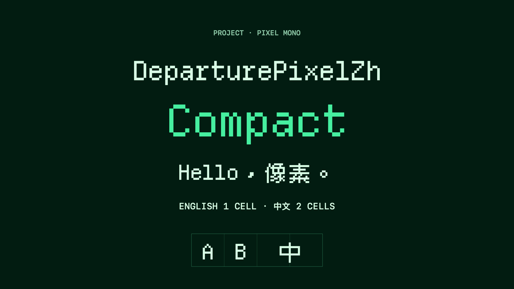

# DeparturePixelZh

[English](README.md) · [简体中文](README.zh-Hans.md) · [日本語](README.ja.md) · [한국어](README.ko.md) · [Español](README.es.md)

## 概要

英字と中国語のピクセル字形を、一つの等幅フォントにまとめました。英字は1セル、中国語の全角文字は2セルを使います。開発者向けアイコンも含みます。カラー絵文字はシステムフォントで表示します。

このソースにはビルド済みフォントを公開していません。含まれるアイコンの再配布権は確認中です。[NOTICE.md](NOTICE.md) を参照してください。



[Departure Mono](https://github.com/rektdeckard/departure-mono)、[Cubic 11](https://github.com/ACh-K/Cubic-11)、Nerd Fonts Symbols Monoを組み合わせたフォントです。

## フォントを選ぶ

| ファミリー | PostScript名 | 文字間隔 |
| --- | --- | --- |
| DeparturePixelZh | `DeparturePixelZh-Regular` | 標準 |
| DeparturePixelZh Compact | `DeparturePixelZhCompact-Regular` | 約7.14%狭い |

どちらもRegularの正体で、行の高さは同じです。Compactは字形と間隔を調整済みなので、アプリ側で字間を変更する必要はありません。

## 使い方

デスクトップにはTTFをインストールし、WebではWOFF2を使います。パッケージにはフォント、チェックサム、出典記録、ライセンス文書が含まれます。再配布やアプリへの同梱時は、`OFL.txt`、`NOTICE.md`、`Licenses/`を保持してください。

[インストールと Web 同梱のガイド](INSTALL.md)を参照してください。リリースは `Licenses/`、ソースリポジトリは `licenses/` を使用します。

Appleアプリで同梱フォントを登録する場合は、正確なPostScript名を指定します。Webでは`local()`を使わずにWOFF2を読み込み、システムの代替フォントも指定してください。

## 再ビルド

[uv](https://docs.astral.sh/uv/) をインストールし、[Builder](https://github.com/codingEzio/DeparturePixelZhBuilder-OSS) を clone して [builder-version](builder-version) の正確なリビジョンを checkout します。以下のコマンドをこのフォントのソースディレクトリで実行し、`/path/to/builder-review-git` を任意のパスに置き換えて、作業ツリーをクリーンに保ってください。

```sh
git clone https://github.com/codingEzio/DeparturePixelZhBuilder-OSS.git "/path/to/builder-review-git"
git -C "/path/to/builder-review-git" checkout --detach "$(cat builder-version)"
```

```sh
uv run --frozen --project "/path/to/builder-review-git" departurepixelzh-builder build --recipe "/path/to/font-source/recipe.json" --output "/path/to/font-build"
uv run --frozen --project "/path/to/builder-review-git" departurepixelzh-builder check --recipe "/path/to/font-source/recipe.json" --output "/path/to/font-build" --release
```

macOS では、ソースチェックアウトから `swift scripts/check_native.swift "/path/to/font-build"` を実行してネイティブフォントを検査できます。スナップショットを使う明示的な開発ビルドの方法は以下を参照してください。

ソースチェックアウトの [recipe.json](recipe.json) は出典 URL と SHA-256 を固定します。ビルダーはその URL から入力をダウンロードするか、キャッシュを再利用し、固定された SHA-256 で検証します。macOS にインストール済みのフォントをビルド入力として読み込むことはありません。ソースチェックアウトの [consumer-fixture/](consumer-fixture/) は、検証済みフォント、ライセンス文書、出典記録を利用側プロジェクトへまとめてコピーする例です。これはフォント ZIP には含まれません。

### 固定リビジョンのビルダー Git とソースのみのエクスポート

`--development` なしのリリース `build`、`check --release`、`package` には、指定された正確でクリーンな Builder の Git 作業ツリーと一致するビルド出典記録が必要です。ネイティブ表示とインストールは別途確認してください。

```sh
uv run --frozen --project "/path/to/builder-source" departurepixelzh-builder build --recipe "/path/to/font-source/recipe.json" --output "/path/to/font-build" --development
uv run --frozen --project "/path/to/builder-source" departurepixelzh-builder check --recipe "/path/to/font-source/recipe.json" --output "/path/to/font-build"
```

## 収録範囲と制限

重複する文字はDeparture Monoを優先し、Cubic 11が残りの中国語文字を補います。Nerd Fonts Symbols Monoが私用領域のアイコンを提供します。生成された収録範囲ファイルで、各コードポイントの出典を確認できます。

Regularの正体のみです。未収録文字とカラー絵文字には代替フォントが必要です。見え方は文字サイズ、画面の拡大率、アプリに依存します。すべてのプラットフォームでの描画を検証したわけではありません。

## 任意：元のフォントと比較する

Homebrewを導入したmacOSでは、元のフォントをインストールして見た目を比較できます。これはビルドの前提条件ではなく、DeparturePixelZhのインストールや利用にも不要です。

```sh
brew install --cask font-departure-mono font-cubic-11
```

## ライセンス

フォントは [SIL Open Font License 1.1](OFL.txt) で配布します。帰属表示、変更点、予約名、各コンポーネントの条件は [NOTICE.md](NOTICE.md) とコンポーネントのライセンス文書を参照してください。ソースチェックアウトでは [licenses/](https://github.com/codingEzio/DeparturePixelZh-OSS/tree/main/licenses)、フォント ZIP では `Licenses/` を使います。DeparturePixelZh は独立した派生名であり、原作者や商標権者の推奨を意味しません。

[ローカルソースの検査と保守](MAINTENANCE.md).

ドキュメント用アイコン：codingEzio、[CC BY 4.0](https://creativecommons.org/licenses/by/4.0/)。 [許諾の範囲](docs/ARTWORK-LICENSE.md)。この許諾は `docs/icon.svg` のみが対象です。既存の画像、フォント、コード、第三者の素材には、それぞれの条件が引き続き適用されます。
