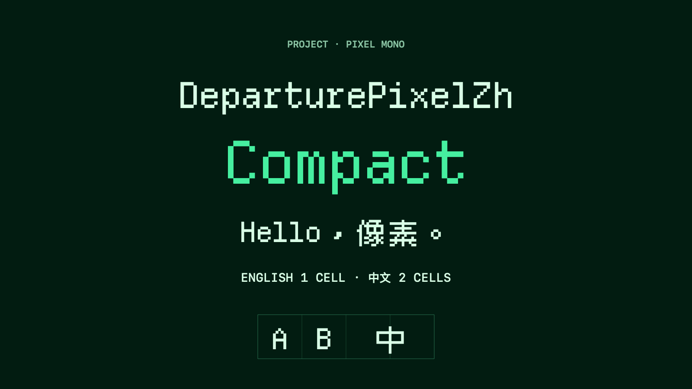

# DeparturePixelZh

[English](README.md) · [简体中文](README.zh-Hans.md) · [日本語](README.ja.md) · [한국어](README.ko.md) · [Español](README.es.md)

## 개요

영문과 중국어 픽셀 글자를 하나의 고정폭 글꼴에 담았습니다. 영문은 한 칸, 중국어 전각 글자는 두 칸을 차지합니다. 개발자 아이콘도 포함합니다. 컬러 이모지는 시스템 글꼴을 사용합니다.

[데스크톱 TTF](https://github.com/codingEzio/DeparturePixelZh-OSS/releases/download/v0.1.1/DeparturePixelZh-0.1.1-desktop.zip) · [웹 WOFF2](https://github.com/codingEzio/DeparturePixelZh-OSS/releases/download/v0.1.1/DeparturePixelZh-0.1.1-web.zip) · [모든 릴리스](https://github.com/codingEzio/DeparturePixelZh-OSS/releases)

두 패키지에는 기본형과 Compact, 체크섬, 출처 기록 및 라이선스 문서가 들어 있습니다. 일부 아이콘의 상위 라이선스 기록은 서로 다릅니다. 구성 요소와 상표 조건은 [NOTICE.md](NOTICE.md)를 참고하세요.



[Departure Mono](https://github.com/rektdeckard/departure-mono), [Cubic 11](https://github.com/ACh-K/Cubic-11), Nerd Fonts Symbols Mono를 조합한 글꼴입니다.

## 글꼴 선택

| 패밀리 | PostScript 이름 | 간격 |
| --- | --- | --- |
| DeparturePixelZh | `DeparturePixelZh-Regular` | 표준 |
| DeparturePixelZh Compact | `DeparturePixelZhCompact-Regular` | 약 7.14% 좁음 |

두 글꼴 모두 Regular 정체이며 줄 높이는 같습니다. Compact는 글자 모양과 간격이 조정되어 있어 앱에서 자간을 따로 바꿀 필요가 없습니다.

## 사용

데스크톱에는 TTF를 설치하고 웹에서는 WOFF2를 사용합니다. 패키지에는 글꼴, 체크섬, 출처 기록, 라이선스 문서가 포함됩니다. 재배포하거나 앱에 포함할 때는 `OFL.txt`, `NOTICE.md`, `Licenses/`를 유지하세요.

[설치 및 웹 포함 안내](INSTALL.md)를 확인하세요. 릴리스는 `Licenses/`, 소스 저장소는 `licenses/`를 사용합니다.

Apple 앱에서 포함된 글꼴을 등록할 때는 정확한 PostScript 이름을 사용하세요. 웹에서는 `local()` 소스 없이 WOFF2 파일을 불러오고 시스템 대체 글꼴도 지정하세요.

## 다시 빌드하기

[uv](https://docs.astral.sh/uv/)를 설치하고 [Builder](https://github.com/codingEzio/DeparturePixelZhBuilder-OSS)를 clone한 다음 [builder-version](builder-version)에 지정된 정확한 리비전을 checkout하세요. 이 글꼴 소스 디렉터리에서 아래 명령을 실행하고 `/path/to/builder-review-git`을 원하는 경로로 바꾸며 작업 트리를 깨끗하게 유지하세요.

```sh
git clone https://github.com/codingEzio/DeparturePixelZhBuilder-OSS.git "/path/to/builder-review-git"
git -C "/path/to/builder-review-git" checkout --detach "$(cat builder-version)"
```

```sh
uv run --frozen --project "/path/to/builder-review-git" departurepixelzh-builder build --recipe "/path/to/font-source/recipe.json" --output "/path/to/font-build"
uv run --frozen --project "/path/to/builder-review-git" departurepixelzh-builder check --recipe "/path/to/font-source/recipe.json" --output "/path/to/font-build" --release
```

macOS에서는 소스 체크아웃에서 `swift scripts/check_native.swift "/path/to/font-build"`를 실행해 네이티브 글꼴을 검사할 수 있습니다. 스냅샷을 명시적으로 개발 빌드하는 방법은 아래를 참고하세요.

소스 체크아웃의 [recipe.json](recipe.json)은 소스 URL과 SHA-256을 고정합니다. 빌더는 해당 URL에서 입력 파일을 다운로드하거나 캐시를 재사용하며, 고정된 SHA-256으로 검증합니다. macOS에 설치된 글꼴을 빌드 입력으로 읽지 않습니다. 소스 체크아웃의 [consumer-fixture/](consumer-fixture/)는 검증한 글꼴, 라이선스 문서, 출처 기록을 사용 프로젝트에 함께 복사하는 예제이며 글꼴 ZIP에는 포함되지 않습니다.

### 고정 버전 빌더 Git과 소스 전용 내보내기

`--development` 없는 릴리스 `build`, `check --release`, `package`에는 지정된 정확하고 깨끗한 Builder Git 작업 트리와 일치하는 빌드 출처 기록이 필요합니다. 네이티브 렌더링과 설치는 별도로 확인해야 합니다.

```sh
uv run --frozen --project "/path/to/builder-source" departurepixelzh-builder build --recipe "/path/to/font-source/recipe.json" --output "/path/to/font-build" --development
uv run --frozen --project "/path/to/builder-source" departurepixelzh-builder check --recipe "/path/to/font-source/recipe.json" --output "/path/to/font-build"
```

## 지원 범위와 한계

겹치는 문자에는 Departure Mono를 우선 사용하고 Cubic 11이 나머지 중국어 문자를 보완합니다. Nerd Fonts Symbols Mono는 사용자 정의 영역의 아이콘을 제공합니다. 생성된 지원 범위 파일에서 각 코드 포인트의 출처를 확인할 수 있습니다.

Regular 정체만 제공합니다. 지원하지 않는 문자와 컬러 이모지는 대체 글꼴이 필요합니다. 화면 표시는 글자 크기, 화면 배율, 앱에 따라 달라집니다. 모든 플랫폼에서 렌더링을 검증한 것은 아닙니다.

## 선택 사항: 원본 글꼴과 비교

Homebrew가 설치된 macOS에서는 원본 글꼴을 설치해 모양을 비교할 수 있습니다. 빌드의 필수 조건이 아니며, DeparturePixelZh를 설치하거나 사용하는 데도 필요하지 않습니다.

```sh
brew install --cask font-departure-mono font-cubic-11
```

## 라이선스

글꼴은 [SIL Open Font License 1.1](OFL.txt)로 배포합니다. 저작자 표시, 변경 사항, 예약 이름, 구성 요소 조건은 [NOTICE.md](NOTICE.md)와 구성 요소 라이선스 문서를 참고하세요. 소스 체크아웃은 [licenses/](https://github.com/codingEzio/DeparturePixelZh-OSS/tree/main/licenses), 글꼴 ZIP은 `Licenses/`를 사용합니다. DeparturePixelZh는 독립적인 파생 이름이며 원저작자나 상표권자의 보증을 뜻하지 않습니다.

[로컬 소스 검사 및 유지 관리](MAINTENANCE.md).

문서 아이콘: codingEzio, [CC BY 4.0](https://creativecommons.org/licenses/by/4.0/). [허가 범위](docs/ARTWORK-LICENSE.md). 이 허가는 `docs/icon.svg`에만 적용됩니다. 기존 이미지, 글꼴, 코드 및 타사 자료에는 각각의 조건이 계속 적용됩니다.
