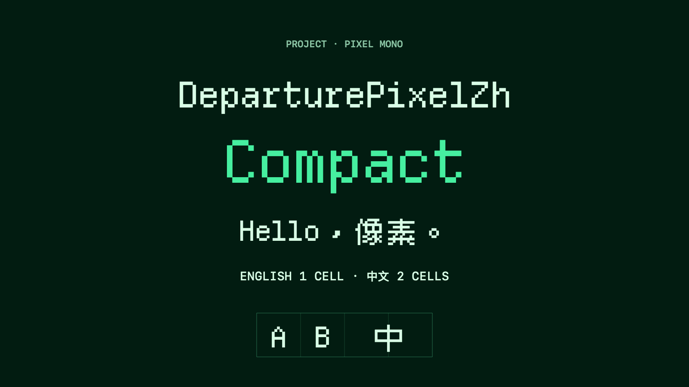

# DeparturePixelZh

[English](README.md) · [简体中文](README.zh-Hans.md) · [日本語](README.ja.md) · [한국어](README.ko.md) · [Español](README.es.md)

## Overview

English and Chinese pixel glyphs in one monospaced font. Latin characters use one cell; full-width Chinese characters use two. Developer icons are included. Color emoji use the system font.

Prebuilt fonts are not published with this source. Redistribution of included icons remains under review; see [NOTICE.md](NOTICE.md).



The family combines [Departure Mono](https://github.com/rektdeckard/departure-mono), [Cubic 11](https://github.com/ACh-K/Cubic-11), and Nerd Fonts Symbols Mono.

## Choose a font

| Family | PostScript name | Spacing |
| --- | --- | --- |
| DeparturePixelZh | `DeparturePixelZh-Regular` | Standard |
| DeparturePixelZh Compact | `DeparturePixelZhCompact-Regular` | About 7.14% tighter |

Both are Regular, upright fonts with the same line height. Compact has fitted glyphs and its own spacing; no application letter-spacing adjustment is needed.

## Use

Install the TTF for desktop use. Use WOFF2 on the web. Packages include fonts, checksums, source records, and license notices. Keep `OFL.txt`, `NOTICE.md`, and `Licenses/` when redistributing or bundling the fonts.

Read the [installation and web bundling guide](INSTALL.md). Release archives use `Licenses/`; this source repository uses `licenses/`.

Apple applications that register a bundled font should use its exact PostScript name. For web use, load the WOFF2 file without a `local()` source and keep a system fallback.

## Rebuild

Install [uv](https://docs.astral.sh/uv/), clone the [Builder](https://github.com/codingEzio/DeparturePixelZhBuilder-OSS), and check out the exact revision in [builder-version](builder-version). Run the checkout command below from this font source directory, replace `/path/to/builder-review-git` with your chosen path, and keep the checkout clean.

```sh
git clone https://github.com/codingEzio/DeparturePixelZhBuilder-OSS.git "/path/to/builder-review-git"
git -C "/path/to/builder-review-git" checkout --detach "$(cat builder-version)"
```

```sh
uv run --frozen --project "/path/to/builder-review-git" departurepixelzh-builder build --recipe "/path/to/font-source/recipe.json" --output "/path/to/font-build"
uv run --frozen --project "/path/to/builder-review-git" departurepixelzh-builder check --recipe "/path/to/font-source/recipe.json" --output "/path/to/font-build" --release
```

On macOS, run `swift scripts/check_native.swift "/path/to/font-build"` from a source checkout for native font checks. The explicit snapshot development route is below.

In a source checkout, [recipe.json](recipe.json) pins source URLs and SHA-256 hashes. The builder downloads those inputs or reuses cached copies, validating them against the pinned hashes. It never reads installed macOS fonts as build inputs. The source checkout’s [consumer-fixture/](consumer-fixture/) shows how to copy verified fonts, notices, and source records into a consumer project; it is not included in the font ZIPs.

### Pinned builder Git and source-only exports

A release `build` (without `--development`), `check --release`, and `package` require the exact clean Builder checkout and matching build provenance. Native rendering and installation remain separate checks.

```sh
uv run --frozen --project "/path/to/builder-source" departurepixelzh-builder build --recipe "/path/to/font-source/recipe.json" --output "/path/to/font-build" --development
uv run --frozen --project "/path/to/builder-source" departurepixelzh-builder check --recipe "/path/to/font-source/recipe.json" --output "/path/to/font-build"
```

## Coverage and limits

Departure Mono has priority for overlapping text characters; Cubic 11 fills remaining Chinese coverage. Nerd Fonts Symbols Mono supplies private-use icons. Generated coverage files identify the source of each included code point.

Only Regular upright faces are provided. Unsupported characters and color emoji need fallback fonts. Appearance depends on font size, display scaling, and the application; the project does not claim verified rendering on every platform.

## Optional: compare the upstream fonts

On macOS with Homebrew, you can install the original fonts for visual comparison. This is not a build prerequisite and is not needed to install or use DeparturePixelZh.

```sh
brew install --cask font-departure-mono font-cubic-11
```

## License

Fonts use the [SIL Open Font License 1.1](OFL.txt). See [NOTICE.md](NOTICE.md) and the component licenses for attribution, modifications, reserved names, and component terms. The source checkout uses [licenses/](https://github.com/codingEzio/DeparturePixelZh-OSS/tree/main/licenses); the font ZIPs use `Licenses/`. DeparturePixelZh is an independent derived name. Source authors and trademark owners do not endorse it.

[Local source checks and maintenance](MAINTENANCE.md).

Documentation icon: codingEzio, [CC BY 4.0](https://creativecommons.org/licenses/by/4.0/). [Scope](docs/ARTWORK-LICENSE.md). This grant covers only `docs/icon.svg`; existing artwork, fonts, code, and third-party material keep their own terms.
