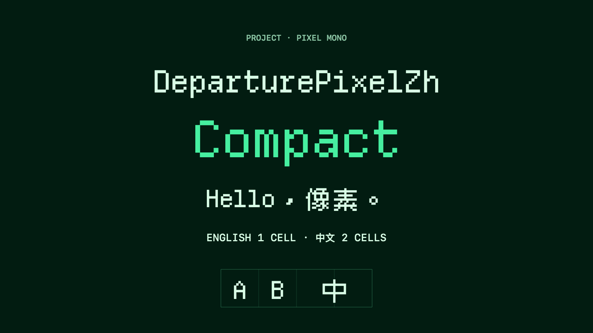

# DeparturePixelZh

[English](README.md) · [简体中文](README.zh-Hans.md) · [日本語](README.ja.md) · [한국어](README.ko.md) · [Español](README.es.md)

## 概览

一款等宽字体，同时装下英文像素字和中文像素字。英文占一格，中文全角字占两格，也包含开发者图标。彩色 emoji 使用系统字体。

此源码尚未发布预构建字体。所含图标的再分发权利仍在审查，详见 [NOTICE.md](NOTICE.md)。



字体组合自 [Departure Mono](https://github.com/rektdeckard/departure-mono)、[Cubic 11](https://github.com/ACh-K/Cubic-11) 和 Nerd Fonts Symbols Mono。

## 选择版本

| 字体 | PostScript 名称 | 间距 |
| --- | --- | --- |
| DeparturePixelZh | `DeparturePixelZh-Regular` | 标准 |
| DeparturePixelZh Compact | `DeparturePixelZhCompact-Regular` | 收紧约 7.14% |

两款均为 Regular 正体，行高相同。Compact 已适配字形和间距，无需另调应用字距。

## 使用

桌面安装 TTF，网页使用 WOFF2。字体包包含字体、校验和、来源记录和许可材料。再分发或随应用捆绑时，请保留 `OFL.txt`、`NOTICE.md` 和 `Licenses/`。

请看[安装与网页内置指南](INSTALL.md)。发布包使用 `Licenses/`，源代码仓库使用 `licenses/`。

Apple 应用注册内置字体时，应使用准确的 PostScript 名称。网页应直接加载 WOFF2，不使用 `local()` 来源，并保留系统备用字体。

## 重新构建

安装 [uv](https://docs.astral.sh/uv/)，克隆 [Builder](https://github.com/codingEzio/DeparturePixelZhBuilder-OSS)，并检出 [builder-version](builder-version) 中记录的精确版本。在本字体源码目录运行以下检出命令，将 `/path/to/builder-review-git` 换成自己的路径，并保持工作区干净。

```sh
git clone https://github.com/codingEzio/DeparturePixelZhBuilder-OSS.git "/path/to/builder-review-git"
git -C "/path/to/builder-review-git" checkout --detach "$(cat builder-version)"
```

```sh
uv run --frozen --project "/path/to/builder-review-git" departurepixelzh-builder build --recipe "/path/to/font-source/recipe.json" --output "/path/to/font-build"
uv run --frozen --project "/path/to/builder-review-git" departurepixelzh-builder check --recipe "/path/to/font-source/recipe.json" --output "/path/to/font-build" --release
```

macOS 可在源码工作区运行 `swift scripts/check_native.swift "/path/to/font-build"`，检查原生字体表现。快照的明确开发构建方式见下文。

源码工作区中的 [recipe.json](recipe.json) 固定来源 URL 和 SHA-256。构建器从这些 URL 下载输入文件，或复用缓存，并按固定的 SHA-256 校验；不会读取 macOS 已安装字体作为构建输入。源码工作区中的 [consumer-fixture/](consumer-fixture/) 演示如何把验证过的字体、许可和来源记录一并复制到使用方项目；字体 ZIP 不包含它。

### 固定版本的构建器 Git 与纯源码导出

不带 `--development` 的发布构建、`check --release` 和 `package` 需要精确且干净的 Builder Git 工作区，以及一致的构建来源记录。原生渲染和安装仍需分别检查。

```sh
uv run --frozen --project "/path/to/builder-source" departurepixelzh-builder build --recipe "/path/to/font-source/recipe.json" --output "/path/to/font-build" --development
uv run --frozen --project "/path/to/builder-source" departurepixelzh-builder check --recipe "/path/to/font-source/recipe.json" --output "/path/to/font-build"
```

## 覆盖与限制

重复的文字字符优先采用 Departure Mono，Cubic 11 补充其余中文覆盖，Nerd Fonts Symbols Mono 提供私用区图标。生成的覆盖文件记录每个收录码位的来源。

目前只提供 Regular 正体。未收录字符和彩色 emoji 需要备用字体。效果取决于字号、屏幕缩放和应用，项目不声称已验证所有平台。

## 可选：对比原版字体

在装有 Homebrew 的 macOS 上，可以安装原版字体做视觉对比。这不是构建前提，安装或使用 DeparturePixelZh 也不需要这一步。

```sh
brew install --cask font-departure-mono font-cubic-11
```

## 许可

字体使用 [SIL Open Font License 1.1](OFL.txt)。署名、修改、保留名称与组件条款见 [NOTICE.md](NOTICE.md) 和组件许可文件。源码工作区使用 [licenses/](https://github.com/codingEzio/DeparturePixelZh-OSS/tree/main/licenses)，字体 ZIP 使用 `Licenses/`。DeparturePixelZh 是独立的衍生名称，不代表原作者或商标权利人为它背书。

[本机源码检查与维护](MAINTENANCE.md).

文档图标：codingEzio，[CC BY 4.0](https://creativecommons.org/licenses/by/4.0/)。 [授权范围](docs/ARTWORK-LICENSE.md)。此授权仅适用于 `docs/icon.svg`；现有图片、字体、代码及第三方材料保留各自条款。
